# Streamline

A movie & TV streamer for Windows/macOS/Linux **and the web**, built on Electron + React +
TypeScript. The desktop app and the web version share one interface and one codebase.
It speaks the **Stremio addon protocol**, so it works with Torrentio, TorrentsDB, MediaFusion,
Comet, Cinemeta, OpenSubtitles and anything else that publishes a `manifest.json`.

You can either **stream** a title — WebTorrent fetches pieces in order and serves them over a
loopback-only HTTP server, so playback starts long before the file is complete — or **download**
it to keep. Downloads run in the background, survive restarts, and are watchable while still in
progress.

Everything it uses is free. No account, no API key, nothing to pay for.

**[Download for Windows](https://github.com/mohameddddt/Streamline/releases/latest)** ·
**[Open the web version](https://mohameddddt.github.io/Streamline/)**

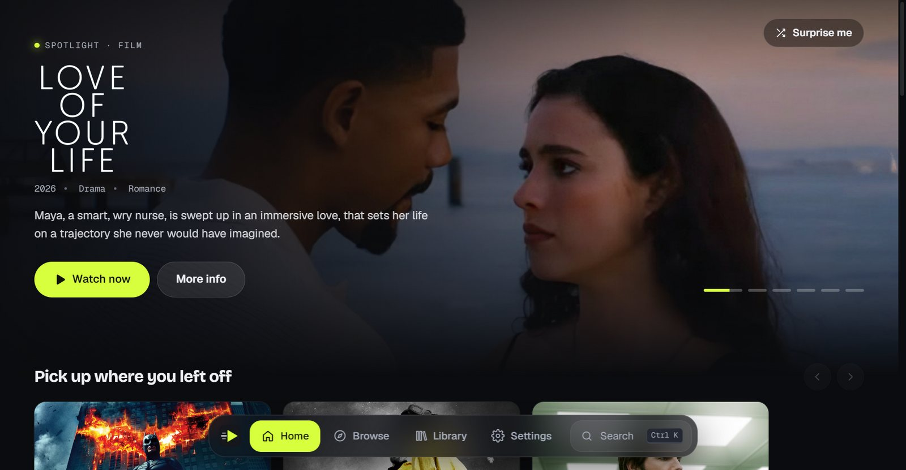

## Screenshots

| | |
| --- | --- |
| 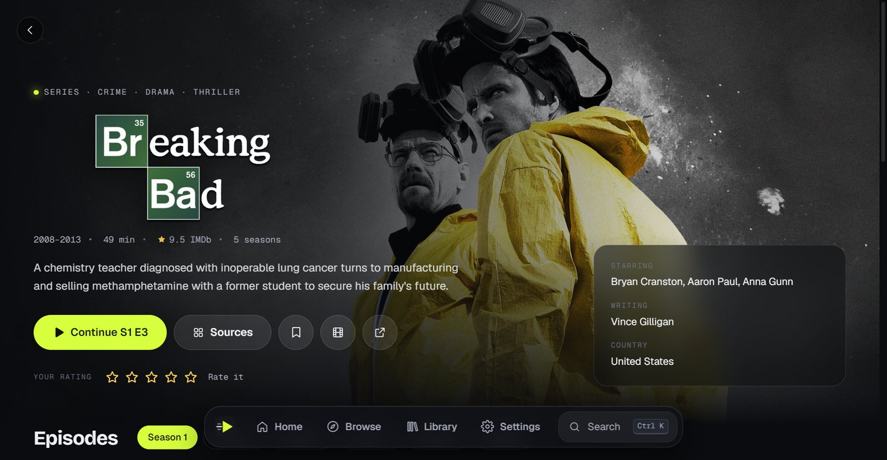 | 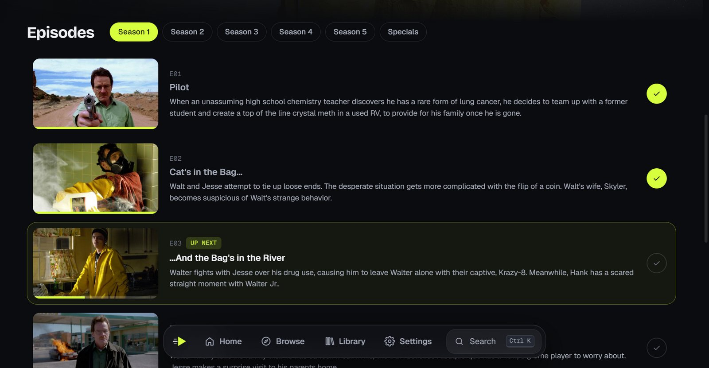 |
| **Title pages** — artwork, your rating, and the next episode to play | **Episodes** — progress per episode, watched ticks, *Up next* |
| 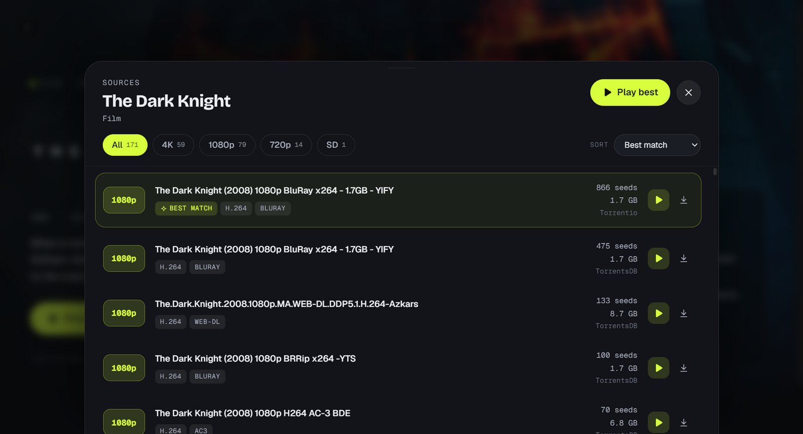 | 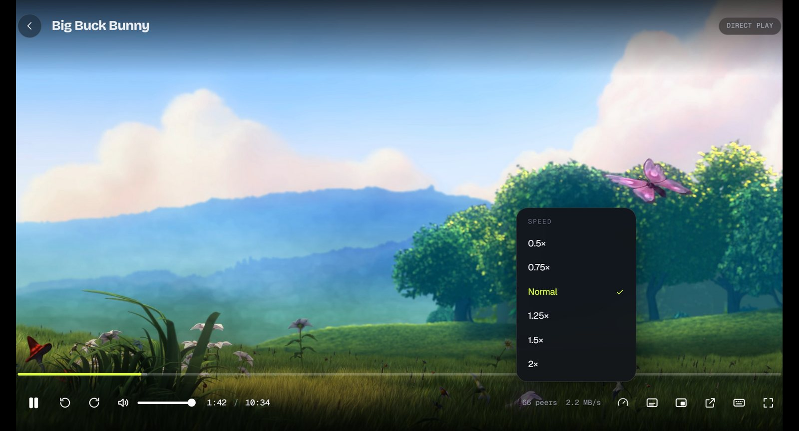 |
| **Smart sources** — quality filters, sorting and one-click *Play best* | **Player** — speed, subtitles, picture-in-picture, shortcuts |
| 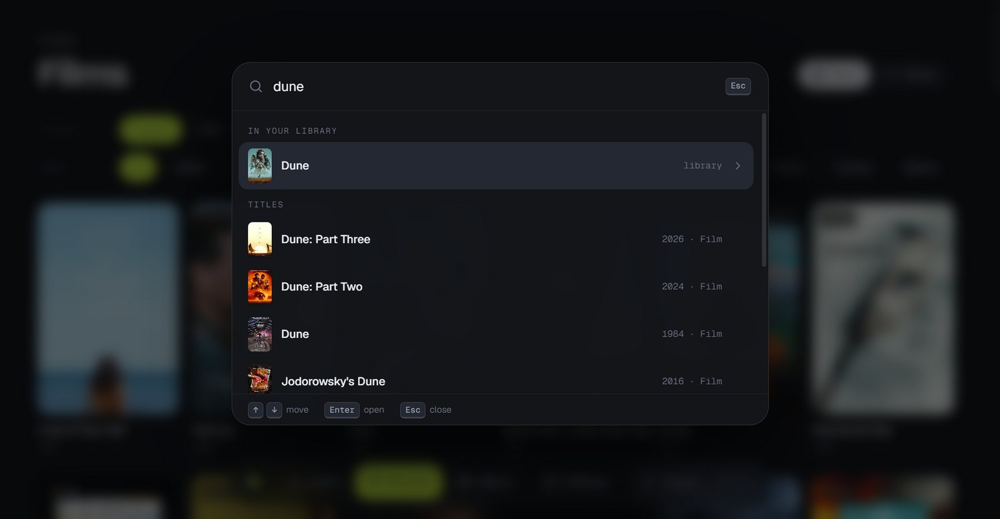 | 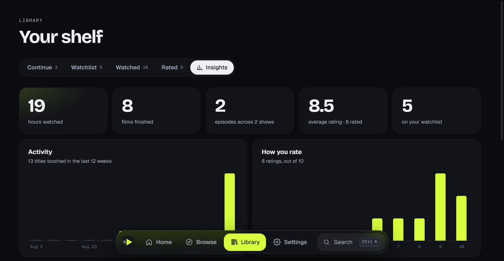 |
| **Search anywhere** — <kbd>Ctrl</kbd> <kbd>K</kbd> | **Insights** — your watching in numbers |
| 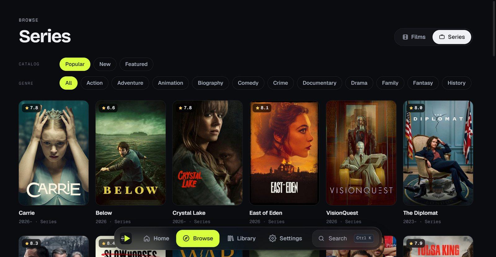 | 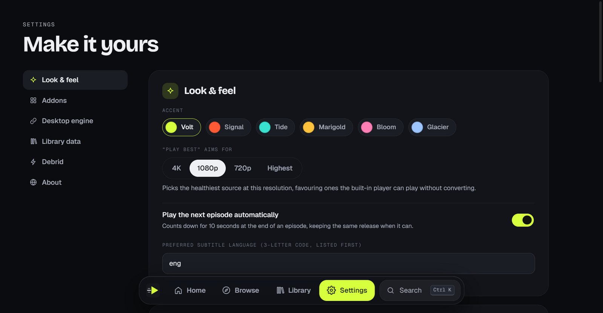 |
| **Browse** — every catalog by type and genre | **Settings** — six accent themes and playback preferences |

On a phone the dock becomes a tab bar:

<p>
  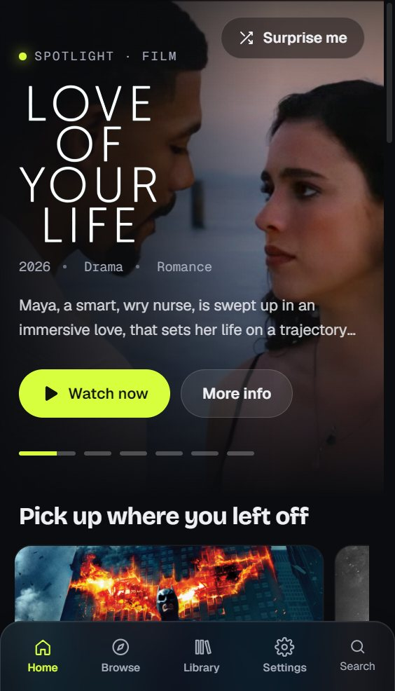
  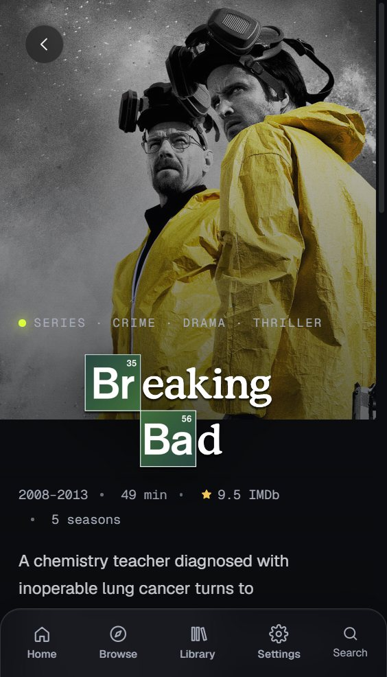
  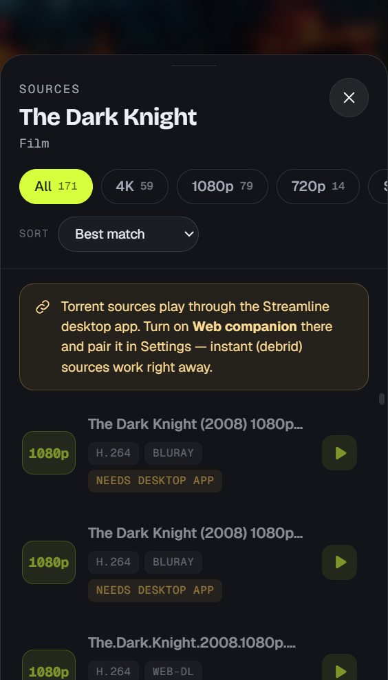
  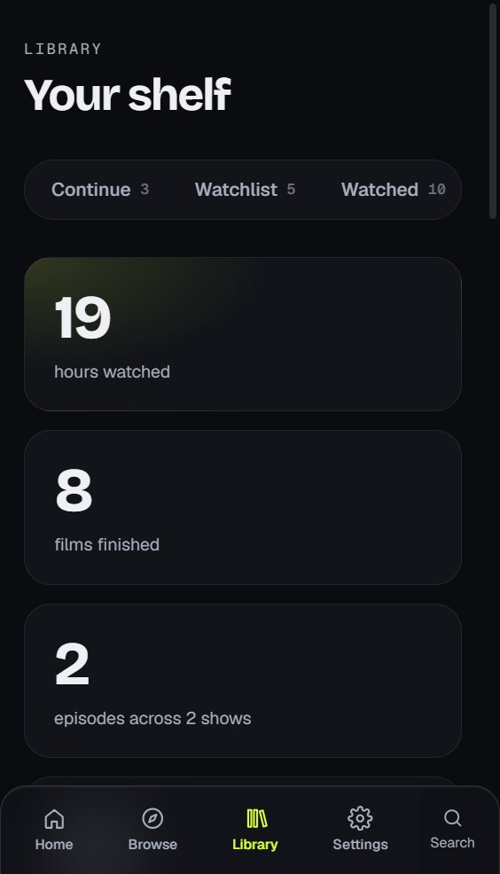
</p>

More in [docs/screenshots/](docs/screenshots/). The player shots use *Big Buck Bunny* (© Blender
Foundation, CC BY 3.0); posters and artwork come from Cinemeta.

## Getting an .exe

```bash
npm install
npm run dist
```

That writes two files into `release/`:

- **Streamline-Setup-0.4.2.exe** — an installer. Run it once and you get a Start-menu and
  desktop shortcut, and it updates cleanly.
- **Streamline-Portable-0.4.2.exe** — a single self-contained file. Double-click it and the app
  runs. Nothing is installed; keep it wherever you like.

For development instead:

```bash
npm run dev       # hot-reloading
npm run build     # bundles into out/
npm start         # run the production bundles
npm run icon      # regenerate resources/icon.ico
```

## The web version

```bash
npm run dev:web       # hot-reloading at http://localhost:5180
npm run build:web     # static site in dist/web/
npm run preview:web   # serve the built site locally
```

It is live at **https://mohameddddt.github.io/Streamline/** — every push to `main` rebuilds and
redeploys it through [.github/workflows/pages.yml](.github/workflows/pages.yml).

`dist/web/` is a plain static site with relative paths, so it can also be hosted anywhere else —
Netlify, a folder on any web server. It runs the same React app as the desktop window with
a browser implementation of `window.api` ([src/web/api.ts](src/web/api.ts)):

- **Catalogs, search, details, sources and subtitles** come straight from your addons in the
  browser (the Stremio protocol requires addons to send CORS headers).
- **Your library and settings** live in the browser's local storage. Settings → Library data
  saves and restores a backup file, which is also how you move a library between the web version
  and the desktop app.
- **Direct links** (debrid, hosted) play right in the browser.
- **Torrents** cannot run in a browser — browsers can't talk to torrent peers. Instead the web
  version hands them to the desktop app's engine through the **Web companion**:
  1. In the desktop app: Settings → Web companion → switch it on, copy the token.
  2. In the web version: Settings → Desktop engine → paste the token → Pair.

  The companion listens on `127.0.0.1:11480` only (never your network), is off until you switch
  it on, and rejects any request without the token, so other websites open in the browser can't
  use it. With it paired, the desktop app also repackages or converts files the browser can't
  decode. Chrome may ask once for permission to reach your local network.

Downloads, history import, Trakt/Simkl sync and external players stay desktop-only; the web
version says so where they would appear.

## What's in the app

- **Home** — a rotating spotlight, *Pick up where you left off* cards, a ranked Top 10, your
  watchlist, genre shortcuts and every catalog shelf. **Surprise me** opens a random well-rated
  pick.
- **Browse** — every catalog by type, catalog and genre, paged in as you scroll.
- **Search anywhere** — <kbd>Ctrl</kbd>/<kbd>⌘</kbd> <kbd>K</kbd> or <kbd>/</kbd> opens a command
  palette: titles in your library match instantly, addon results follow, app actions underneath.
- **Smart sources** — each source's resolution, HDR, codec, release type, audio, size and seeds
  are read out of the addon's text. Filter by quality, sort by seeds/size/quality, or hit
  **Play best**: it aims for your preferred resolution (Settings → Look & feel), favours healthy
  torrents and files the built-in player can play without converting, and avoids CAM releases.
- **Series that keep going** — the detail page knows which episode is up next (*Continue S2 E3*),
  shows progress per episode and lets you tick episodes watched. Near the end of an episode the
  player offers the next one with a 10-second countdown, staying with the same release when the
  addon marks one (`bingeGroup`).
- **Player** — speed control, subtitle size and delay, picture-in-picture, a buffered bar and
  hover times on the scrubber, and a shortcut sheet on <kbd>?</kbd>.
- **Your ratings** — rate anything out of 10 from its page; ratings show on posters.
- **Insights** — hours watched, films and episodes finished, average rating, twelve weeks of
  activity and how you rate.
- **Accents** — six colour themes in Settings → Look & feel.

## How it fits together

| Path | Role |
| --- | --- |
| [src/main/index.ts](src/main/index.ts) | Electron main process, window, all IPC handlers |
| [src/main/addons.ts](src/main/addons.ts) | Desktop wiring for the shared addon client |
| [src/main/companion.ts](src/main/companion.ts) | Loopback API that lets the web version use this engine |
| [src/main/torrent.ts](src/main/torrent.ts) | WebTorrent engine + range-capable local stream server |
| [src/main/downloads.ts](src/main/downloads.ts) | Download manager: queue, pause/resume, disk storage |
| [src/main/playback.ts](src/main/playback.ts) | Codec probing + on-the-fly remux/transcode via ffmpeg |
| [src/main/trackers.ts](src/main/trackers.ts) | Trakt + Simkl scrobbling, Letterboxd CSV export |
| [src/main/updater.ts](src/main/updater.ts) | Self-update from GitHub Releases |
| [src/main/settings.ts](src/main/settings.ts) | Settings, library and watch-progress storage on disk |
| [src/preload/index.ts](src/preload/index.ts) | Typed `window.api` bridge (contextIsolation on) |
| [src/renderer/src/pages/](src/renderer/src/pages/) | Home, Browse, Search, Detail, Player, Library, Settings |
| [src/shared/addons.ts](src/shared/addons.ts) | Stremio addon client, used by both builds |
| [src/shared/library.ts](src/shared/library.ts) | Library rules (progress, ratings, imports, backups), used by both builds |
| [src/shared/streams.ts](src/shared/streams.ts) | Parses and ranks sources for filters and "Play best" |
| [src/shared/types.ts](src/shared/types.ts) | Types shared across every process and both builds |
| [src/web/](src/web/) | Web entry point and the browser `window.api` |

The renderer never touches Node or the network directly — everything goes through `window.api`,
which is IPC on the desktop and [src/web/api.ts](src/web/api.ts) in the browser. Both
implement the same TypeScript type, so the compiler keeps them in step.

## Addons

Four are installed by default:

- **Cinemeta** `https://v3-cinemeta.strem.io/manifest.json` — catalogs and metadata
- **Torrentio** `https://torrentio.strem.fun/manifest.json` — torrent sources
- **TorrentsDB** `https://torrentsdb.com/manifest.json` — torrent sources
- **OpenSubtitles v3** `https://opensubtitles-v3.strem.io/manifest.json` — subtitles

Add any other addon in Settings by pasting its `manifest.json` URL. If an addon has a configure
page, configure it there first and paste the personalised URL it hands back — that URL carries
your options in it.

### Built-in sources

Three more ship with the app. They answer in-process under a `streamline://` URL, sit in the same
addon list, and can be reordered or removed like any other (Settings offers them again if you do):

- **Internet Archive** (desktop and web) — a *Public domain films* catalog from archive.org's
  curated film collections, with search, genre filters and paging. Items must carry a Creative
  Commons / public-domain licence or predate 1978. Each film comes as direct links, which play
  straight in the browser too, plus the Archive's own torrent so it can be downloaded to keep.
  When a film on an ordinary IMDb title page is also on the Archive, those copies are offered
  there as well, matched by title, year and runtime.
- **Open movies** (desktop and web) — the Blender Foundation's Creative Commons films (Big Buck
  Bunny, Sintel, Tears of Steel, Cosmos Laundromat, Elephants Dream) as web-seeded torrents.
- **Local library** (desktop) — pick folders in Settings → Local library and your own files are
  matched to Cinemeta by name (`Title (Year).mkv`, `Show S01E02.mp4`), get their artwork, and play
  from their title page in the built-in player, listed first since they start instantly. Subtitle
  files next to a video (`Film.en.srt`) are picked up. Files that cannot be matched still play,
  listed under their file name. Folders are rescanned on launch and when you press *Rescan*.

Torrents whose metadata is hosted over HTTP (the `xs` magnet parameter) — the Archive's and the
open films' — start without waiting for peers, then download from their web seeds.

## Watching vs. downloading

Every source in the list has two actions:

- **Click the row** to stream it now. Pieces are fetched in order into a temporary cache that is
  wiped when the app closes.
- **The download button** (desktop) downloads it properly. The file goes to your Downloads folder (configurable), is
  never auto-deleted, and keeps going in the background while you browse. It survives restarts —
  unfinished downloads resume automatically.

A download is playable before it finishes: hitting Play on a partial download streams from the
same torrent, and once complete it plays straight off disk.

## Library

- **Continue** — anything started but under 95% complete, with resume positions; remove an entry
  with the × on its card
- **Watchlist** — titles bookmarked from their page
- **Watched** — anything finished, kept as history
- **Rated** — everything you have rated, best first, shown as a ★ on the poster
- **Downloads** (desktop) — progress, speed, peers, pause/resume, show-in-folder, delete
- **Insights** — your numbers and charts

### Picking up where you left off

The source you last played for a title (per movie, per episode) is remembered. Opening its source
list puts that one first, marked **Last played**, even before the addons have finished
answering — and **Watch now** goes straight back to it.

### Importing your history

Settings → **Import your history** brings watched titles, ratings and watchlists into the library.
Titles are matched to IMDb through Cinemeta (exact year beats a near one); anything that cannot be
matched is listed so you can add it by hand. Existing library entries are never overwritten.

- **Letterboxd** — the export ZIP (watched, ratings, diary dates and watchlist)
- **IMDb** — a ratings or list CSV export
- **Serializd** and anything else — any CSV with a title column; year, rating, date, IMDb id and
  type columns are used when present. Serializd has no export of its own, so use a CSV from a
  browser export extension or TV Time
- **Trakt / Simkl** — pulled straight from the connected account (see below)

Ratings out of 5 and out of 10 are both understood and stored on a 10-point scale.

## Watch tracking

**Trakt and Simkl** both have free public APIs, so Streamline scrobbles to them live: it marks
playback started, paused and finished, and a title passing 80% is recorded as watched. Register a
free app on either site, paste the client ID into Settings, and approve the device code that
appears.

**Letterboxd and Serializd cannot be synced automatically.** Letterboxd grants API access only on
request, and Serializd has no public API at all. Instead, Settings exports your history as CSV —
the Letterboxd file carries an `imdbID` column, which their importer matches on exactly.

## Updating

Your settings, library and downloads live outside the install folder (`%APPDATA%\Streamline` and
your downloads folder), so they always survive an update.

Running a newer `Streamline-Setup-*.exe` upgrades in place. For automatic updates, set your repo
under `build.publish` in [package.json](package.json), replacing `YOUR_GITHUB_USERNAME`, and
publish releases with `npx electron-builder --win --publish always`. The app then checks on
startup, downloads in the background, and installs on quit. Until that is set, the Updates panel
in Settings reports that no update server is configured.

## Debrid (optional, paid — off by default)

Streamline is fully functional for free over peer-to-peer torrents, which is the default. If you
ever want one, setting a debrid provider + API key in Settings rewrites the config segment of any
Torrentio-style addon URL so results come back as direct HTTPS links.

## Codecs — everything plays in-app

Chromium alone only decodes H.264/AAC, which leaves out the HEVC, AC3 and DTS releases that make
up a lot of good torrents. Streamline bundles its own ffmpeg and puts it in front of the player:

1. **ffprobe** inspects the file first.
2. If Chromium can already handle it, it plays **direct** — no ffmpeg, native seeking.
3. If only the audio is unsupported (the common AC3 case), it **remuxes**: the video is copied
   untouched and only the audio becomes AAC. Near-zero CPU, starts immediately.
4. If the video itself is unsupported (HEVC), it **transcodes**, preferring a hardware encoder
   (NVENC / QuickSync / AMF) and falling back to x264.

Each encoder is verified by actually encoding a frame at startup, because `ffmpeg -encoders`
lists what was compiled in rather than what your GPU can run.

Remuxed and transcoded output is a live pipe, so it cannot be seeked natively. The player handles
that itself: seeking restarts ffmpeg at the new timestamp and offsets the clock. Because a copied
video stream can only start on a keyframe, a seek can land up to one GOP (typically ~2s) early.

VLC is no longer required. The **Open in external player** button is still there if you want it.

## Note

Streamline ships with no content. What you can legally stream through it depends on the addons you
install and the rights you hold in your country.
